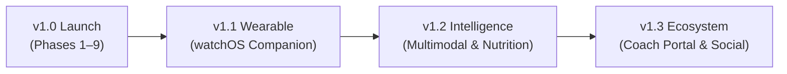

# Total Factor — Product & Engineering Roadmap

**Document**: Long-Range Roadmap & Milestones  
**Target Release**: iOS 17.0+ / watchOS 10.0+  
**Current Milestone**: v1.0 Production Readiness (Phases 1–9 Complete)

---

## 1. Guiding Principles & Product Philosophy

1. **Friction is the Enemy**:
   - Every additional tap decreases adherence. Repeat food logging must stay $\le 2\text{ taps}$. Gym set logging must stay strictly $1\text{ tap}$.
2. **Deterministic & Inspectable Math**:
   - No black-box estimations. Every macro recommendation, expenditure adjustment, and progression suggestion must be mathematically transparent and rule-grounded.
3. **No Double-Counting Wearables**:
   - Wrist-worn calorie burn metrics are inherently noisy and will always remain strictly **display-only**. Energy expenditure must always be anchored to true observed scale trends and logged intake.
4. **Offline-First Resilience**:
   - Zero reliance on external servers to open the app, log food, calculate plates, track sets, or run progression math.

---

## 2. Release Milestones Overview

---

## 3. Milestone Details

### Milestone 1: v1.0 Production Release (Current Focus)
**Target Date**: Q4 2026  
**Objective**: Package, test, and release the core 9-phase application to the Apple App Store.

#### High-Priority Tasks:
- [x] **Core Engines & UI**: 100% of Phases 1 through 9 implemented.
- [x] **Unit Testing**: Complete SPM/XCTest algorithm test harness.
- [x] **Full USDA Bulk Ingestion**:
  - Run `Scripts/build_full_usda_bundle.py` with USDA Foundation and SR Legacy datasets to expand the bundled offline database from 78 items to 8,156 lab-verified foods indexed via `OfflineUSDACatalogService`.
- [ ] **TestFlight Internal Testing**:
  - Distribute build to initial cohort of 15–20 beta testers for real-world gym and kitchen UX feedback.
- [ ] **App Store Preparation**:
  - Capture 6.7" (iPhone 15/16 Pro Max) and 6.1" (iPhone 15/16 Pro) App Store screenshots showcasing:
    - Today Dashboard & MacroZoneBar
    - Active Workout logger with live PR celebrations
    - Adaptive Expenditure & Weight Trend curves
    - Rest Timer on Dynamic Island & Live Activity
  - Draft Apple App Privacy Nutrition Labels (Health data, offline storage, local analytics).

---

### Milestone 2: v1.1 watchOS Companion (`TotalFactorWatch`)
**Target Date**: Q1 2027  
**Objective**: Untether gym logging from the iPhone so lifters can log sets and time rests directly from their wrist.

#### Planned Features:
- **Wrist Set Logging**:
  - 1-tap `✓` set completion directly from Apple Watch.
  - Haptic countdown pulses at $0:05$, $0:03$, $0:02$, $0:01$, and completion of rest timers.
- **Heart Rate & HealthKit Session**:
  - Active `HKWorkoutSession` on watchOS feeding continuous heart rate metrics into the iPhone workout recap.
- **Watch Complications & Smart Stack**:
  - Circular and Rectangular complications showing remaining calories and current workout state.
- **Shared Codebase Leverage**:
  - Direct consumption of `Shared/RestTimerAttributes.swift` and `Shared/SharedSnapshotStore.swift` across both targets.

---

### Milestone 3: v1.2 Smart Nutrition & Vision Intelligence
**Target Date**: Q2 2027  
**Objective**: Accelerate food entry for complex dining and home-cooked multi-ingredient dishes.

#### Planned Features:
- **Multimodal Visual Meal Estimation**:
  - On-device CoreML / Gemini Vision analysis of meal photos to suggest approximate portion breakdowns and macro ranges.
- **Multi-Item Grocery Receipt Parser**:
  - Optical character recognition on grocery store receipts to batch-populate the custom food pantry.
- **Barcode Database Fallback Expansion**:
  - Integrated crowd-sourced barcode resolution cascade with automated nutrient sanity checks.
- **Dynamic Micro-Goals**:
  - Automated hydration and sodium alerts during high-volume training weeks and hot weather.

---

### Milestone 4: v1.3 Coach Portal & Export Ecosystem
**Target Date**: Q3 2027  
**Objective**: Empower remote coaches and athletes to share data, programs, and progress without compromising privacy.

#### Planned Features:
- **CloudKit Private Zone Sharing**:
  - Enable lifters to share read-only access to their `WeeklyCheckIn`, `ExpenditureEstimate`, and `WorkoutSession` logs with a coach's Apple ID.
- **Rich Shareable PR & Milestone Cards**:
  - Auto-generate aesthetic Instagram Story / message cards for PRs, 8-week transformations, and check-in recaps.
- **Comprehensive Data Interoperability**:
  - Expanded exports for Strong, Hevy, MyFitnessPal, and Cronometer CSV formats.

---

## 4. Technical Debt & Architectural Backlog

| Area | Item | Impact | Complexity | Priority |
|---|---|:---:|:---:|:---:|
| **Storage** | SwiftData explicit `VersionedSchema` and `SchemaMigrationPlan` | High | Medium | Medium |
| **Performance** | CoreData SQLite background thread indexing for $>10,000$ food logs | Medium | Medium | Low |
| **Localization** | `String Catalog` (`.xcstrings`) for Spanish, German, French, and Japanese | High | Medium | High |
| **Accessibility** | Dynamic Type and VoiceOver accessibility audits across custom keypads | High | Low | High |
